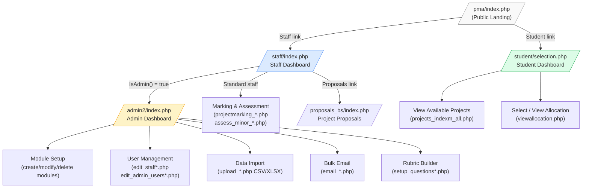
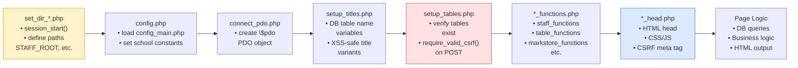
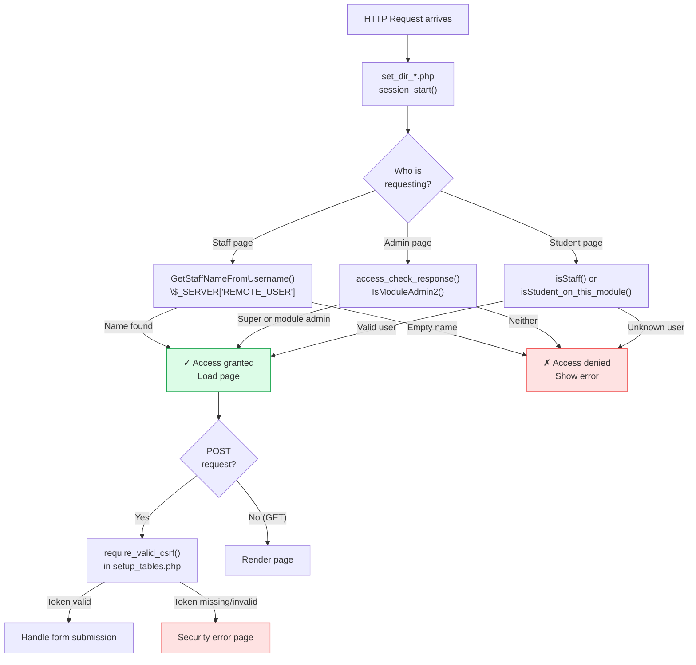
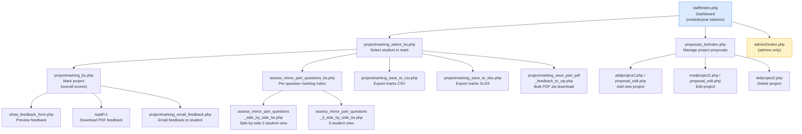
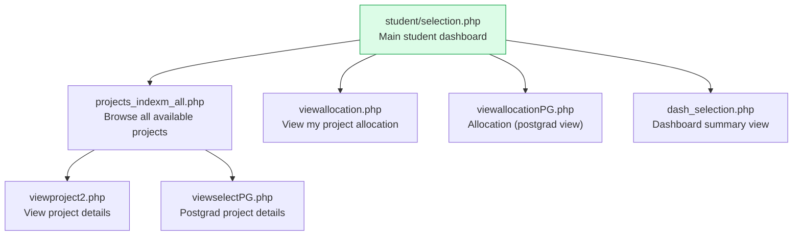
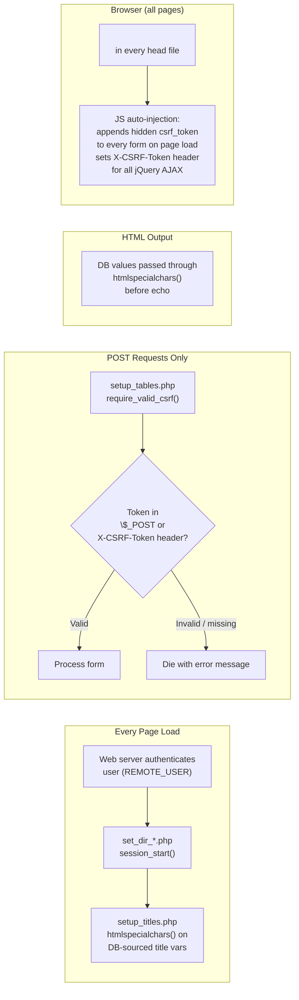
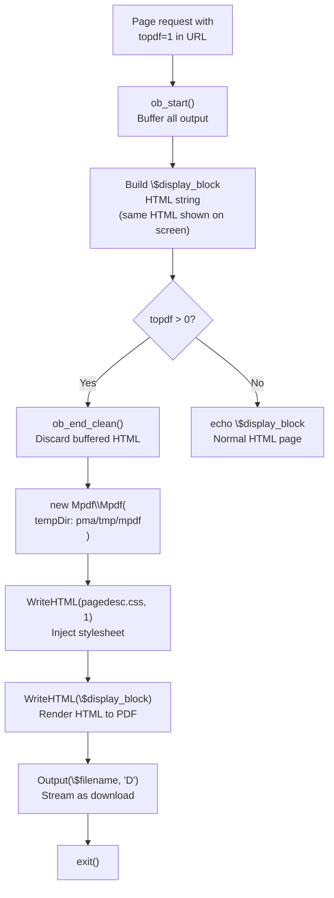

# PMA2 — Architecture Overview

A guide for new developers. This document covers how the application is structured, how pages bootstrap themselves, the three access tiers, and the key user flows.

---

## Table of Contents

1. [What This Application Does](#1-what-this-application-does)
2. [Technology Stack](#2-technology-stack)
3. [Directory Structure](#3-directory-structure)
4. [The Three Access Tiers](#4-the-three-access-tiers)
5. [Standard Include Chain](#5-standard-include-chain)
6. [Authentication Flow](#6-authentication-flow)
7. [Staff User Flow](#7-staff-user-flow)
8. [Student User Flow](#8-student-user-flow)
9. [Admin User Flow](#9-admin-user-flow)
10. [Key Shared Files](#10-key-shared-files)
11. [UI Versions — Bootstrap Migration](#11-ui-versions--bootstrap-migration)
12. [Security Architecture](#12-security-architecture)
13. [PDF Generation](#13-pdf-generation)
14. [Database & Config](#14-database--config)

---

## 1. What This Application Does

PMA (Project Marking Application) is a web-based university project assessment system. It manages:

- **Project proposals** — staff propose projects, students select them
- **Project marking** — staff mark student projects using configurable rubrics
- **Feedback generation** — PDF feedback forms sent to students
- **Administration** — module setup, student/staff allocation, marking criteria upload

There are three classes of user: **Students**, **Staff**, and **Admins** (staff with elevated privileges).

---

## 2. Technology Stack

| Layer | Technology |
|---|---|
| Language | PHP 7/8 (procedural with some OOP for libraries) |
| Database | MySQL via PDO |
| Frontend | jQuery 3.2.1, jQuery UI 1.12.1, DataTables 1.10.16 |
| UI Framework | Bootstrap 5.2.3 (newer pages) / Bootstrap 3.3.7 (older pages) |
| PDF Generation | mPDF 8.x (via Composer, namespace `\Mpdf\Mpdf`) |
| Server | Apache/XAMPP |
| Session | PHP native sessions (started in `set_dir_*.php`) |

---

## 3. Directory Structure

```
PMA2/
├── db_credentials.php          ← Database credentials (NOT in git)
├── db_credentials.example.php  ← Template for credentials
├── composer.json               ← mPDF dependency
├── ARCHITECTURE.md             ← This file
├── SECURITY_FIXES.md           ← Security changelog
├── UNUSED_FILES.md             ← Files flagged for review/removal
└── pma/
    ├── index.php               ← Public landing page (checks DB, shows tier links)
    ├── config_main.php         ← Master config: DB settings, school definitions
    ├── tmp/                    ← Runtime temp files (mPDF output, not in git)
    │
    ├── staff/                  ← Staff marking & assessment (44 files)
    │   ├── set_dir_staff.php   ← Path init + session_start (loaded first)
    │   ├── config.php          ← Loads config_main.php
    │   ├── connect_pdo.php     ← PDO DB connection object ($pdo)
    │   ├── setup_titles.php    ← DB table name variables + XSS-safe title variants
    │   ├── setup_tables.php    ← Table existence checks + CSRF guard
    │   ├── csrf_functions.php  ← CSRF token generation & validation
    │   ├── staff_functions.php ← Core staff functions
    │   ├── *_functions.php     ← Other function libraries (see §10)
    │   ├── index.php           ← Staff dashboard (entry point)
    │   ├── projectmarking*.php ← Marking workflow pages
    │   ├── assess_minor_*.php  ← Per-question assessment pages
    │   ├── show_*_form.php     ← Feedback display pages
    │   ├── desktop_head.php    ← <head> fragment for desktop pages
    │   ├── mobile_head_bs.php  ← <head> fragment for Bootstrap 5 pages
    │   │
    │   ├── proposals/          ← Project proposal management — classic UI (13 files)
    │   │   └── set_dir_props.php, index.php, add/mod/del project2.php …
    │   │
    │   ├── proposals_bs/       ← Project proposal management — Bootstrap 5 (6 files)
    │   │   └── set_dir_props.php, index.php, proposal_edit.php …
    │   │
    │   └── admin2/             ← System administration (80 files)
    │       ├── set_dir_admin.php
    │       ├── index.php       ← Admin dashboard (entry point)
    │       ├── first_use_staff.php ← First-run setup wizard
    │       ├── edit_*.php      ← Table/config editors
    │       ├── upload_*.php    ← CSV/XLSX data importers
    │       ├── email_*.php     ← Bulk email senders
    │       └── setup_questions*.php ← Marking rubric builders
    │
    └── student/                ← Student project selection (16 files)
        ├── set_dir_student.php
        ├── selection.php       ← Student entry point
        └── admin/              ← Staff-side student views (5 files)
```

---

## 4. The Three Access Tiers



---

## 5. Standard Include Chain

Every page in the application follows the same bootstrap pattern. The `set_dir_*.php` file is always included first — it starts the session and defines path constants that all subsequent includes use.



**Example** — `staff/projectmarking_select_bs.php` includes in order:

```php
require_once 'set_dir_staff.php';  // paths + session
require_once 'config.php';         // school config
require_once 'setup_titles.php';   // table names
require_once 'connect_pdo.php';    // $pdo
require_once 'setup_tables.php';   // table checks + CSRF guard
require_once 'admin2/adminusers.php'; // auth helpers
```

Then outputs HTML using `mobile_head_bs.php` as the `<head>` fragment.

---

## 6. Authentication Flow



**Key point:** Authentication relies on the web server (`REMOTE_USER`) — Apache must be configured to authenticate users before PHP runs. There is no login form in the application itself.

---

## 7. Staff User Flow



---

## 8. Student User Flow



---

## 9. Admin User Flow

```mermaid
flowchart TD
    ADM["admin2/index.php\nAdmin Dashboard"]

    ADM --> FIRST["first_use_staff.php\nFirst-run setup wizard\n(creates DB tables)"]

    ADM --> MOD["Module Management"]
    MOD --> CREATE_MOD["create_new_module_entry.php"]
    MOD --> EDIT_MOD["modify_module_entry.php"]
    MOD --> DEL_MOD["delete_module.php"]
    MOD --> DUP_MOD["duplicate_module.php"]
    MOD --> VIS["edit_module_visibility.php\nedit_project_visibility.php"]

    ADM --> CRITERIA["Assessment Criteria"]
    CRITERIA --> SETUP_Q["setup_questions.php\nsetup_questions2.php\nBuild marking rubrics"]
    CRITERIA --> UPLOAD_A["upload_assessment_criteria\n_csv.php / _xlsx.php\nImport criteria"]

    ADM --> DATA["Data Management"]
    DATA --> STUD_TBL["modify_student_table.php\nEdit student records"]
    DATA --> UPLOAD_S["upload_student_project\n_allocation_*.php\nImport allocations"]
    DATA --> UPLOAD_T["upload_totals_for_part*.php\nImport existing marks"]

    ADM --> STAFF_MGT["Staff Management"]
    STAFF_MGT --> EDIT_ST["edit_staff_table_bs.php\nManage staff list"]
    STAFF_MGT --> EDIT_ADM["edit_admin_users.php\nManage admin privileges"]

    ADM --> COMMS["Communications"]
    COMMS --> EMAIL_S["email_students.php\nEmail all students"]
    COMMS --> EMAIL_ALLOC["email_project_allocation\n_to_students.php"]
    COMMS --> EMAIL_FB["email_project_feedback\n_to_students.php"]

    ADM --> SCHOOL["School Settings"]
    SCHOOL --> CHANGE_DEF["change_school_definition_new.php\nEdit school/module config"]
    SCHOOL --> UPLOAD_IMG["upload_header_image.php\nUpload branding image"]

    ADM --> DASH_FB["edit_dash_feedback_tools.php\nConfigure feedback dashboard"]

    style ADM fill:#fef3c7,stroke:#f59e0b
    style FIRST fill:#fee2e2,stroke:#ef4444
```



---

## 10. Key Shared Files

These files are included by many pages. If you change one of these, check the impact across the whole application.

| File | Purpose | Used By |
|---|---|---|
| `staff/set_dir_staff.php` | Path constants, `session_start()` | Every staff page |
| `staff/config.php` | Loads `config_main.php`, sets school constants | Every staff page |
| `staff/connect_pdo.php` | Creates `$pdo` PDO database object | Every staff page |
| `staff/setup_titles.php` | DB table name variables; XSS-safe `$school_title_h` | Every staff page |
| `staff/setup_tables.php` | Verifies tables exist; **CSRF guard on all POSTs** | Every staff page |
| `staff/csrf_functions.php` | `generate_csrf_token()`, `validate_csrf_token()`, `pma_log_db_error()` | setup_tables + head files |
| `staff/staff_functions.php` | `GetStaffNameFromUsername()`, `IsAdmin()`, `IsModuleAdmin()` | Most staff pages |
| `staff/table_functions.php` | Generic DB table helpers | Most staff pages |
| `staff/pdo_query_functions.php` | PDO query wrappers | Most staff pages |
| `staff/markstore_functions.php` | Save/retrieve marks from DB | Marking pages |
| `staff/staff_student_functions.php` | Functions shared between staff & student tiers | Both tiers |
| `staff/show_feedback_form.php` | `show_feedback_form()` function — renders feedback HTML | Marking + PDF pages |
| `staff/admin2/adminusers.php` | `access_check_response()`, `IsModuleAdmin2()` | Admin + staff pages |
| `staff/admin2/admin_functions.php` | Admin-specific DB helpers | Admin pages |
| `staff/admin2/utility_functions.php` | General admin utilities | Admin + student pages |

---

## 11. UI Versions — Bootstrap Migration

Many pages exist in two versions. The project is in the process of migrating from a non-Bootstrap desktop layout and Bootstrap 3 mobile layout to **Bootstrap 5** throughout.

| Suffix / Location | UI Framework | Status |
|---|---|---|
| `*_bs.php` in `staff/` | Bootstrap 5.2.3 | Current / preferred |
| `*.php` (no suffix) in `staff/` | No framework (desktop) or Bootstrap 3 | Legacy — being replaced (several already removed) |
| `proposals_bs/` | Bootstrap 5.2.3 | Current |
| `proposals/` | Bootstrap 3.3.7 | Legacy |
| `admin2/*_bs.php` | Bootstrap 5.2.3 | Current |
| `admin2/*.php` (no suffix) | No framework / Bootstrap 3 | Legacy |
| `student/` | Bootstrap 3.3.7 | Not yet migrated |

**Head file mapping:**

| Head File | Framework | Used By |
|---|---|---|
| `staff/mobile_head_bs.php` | Bootstrap 5 | Staff `_bs` pages |
| `staff/desktop_head.php` | No framework | Legacy desktop staff pages |
| `staff/mobile_head.php` | Bootstrap 3 | Legacy mobile staff pages |
| `admin2/mobile_head_admin_bs.php` | Bootstrap 5 | Admin `_bs` pages |
| `admin2/admin_desktop_head.php` | No framework | Legacy admin desktop pages |
| `proposals_bs/mobile_head_props.php` | Bootstrap 3 | Proposals pages |

---

## 12. Security Architecture



**Key security files:**
- `staff/csrf_functions.php` — token generation, validation, DB error logging
- All `*head*.php` files — CSRF meta tag + JS auto-injection script
- `staff/setup_tables.php` — universal POST guard (`require_valid_csrf()`)
- `staff/setup_titles.php` — XSS-safe title variants (`$school_title_h`, `$running_title_h`)

---

## 13. PDF Generation

PDF feedback reports are generated using **mPDF 8.x** (Composer package `mpdf/mpdf`).



**Important:** mPDF requires `pma/tmp/mpdf/` to exist and be writable by the web server (`chmod 777`). This directory is excluded from git via `.gitignore`.

Pages that generate PDFs:
- `assess_minor_part_questions_bs.php` and its side-by-side variants (`_side_by_side_bs.php`, `_3_side_by_side_bs.php`)
- `show_overall_mark_feedback_pdf.php`
- `projectmarking_save_part_pdf_feedback_to_zip.php` (bulk ZIP)

---

## 14. Database & Config

### Config loading chain

```
db_credentials.php          (server-specific, not in git)
    └── pma/config_main.php (reads credentials, defines school settings)
            └── pma/staff/config.php (loaded by every staff page)
```

### Key variables set by config

| Variable | Description |
|---|---|
| `$pdo` | PDO database connection object |
| `$school_title` | School/department name |
| `$running_title` | Current module/year title |
| `$school_title_h` | XSS-safe version (use in HTML output) |
| `$running_title_h` | XSS-safe version (use in HTML output) |
| `$STAFF_ROOT` | Absolute filesystem path to `staff/` |
| `$STAFF_DIR_VAL` | Same as `$STAFF_ROOT` (legacy alias) |
| Table name vars | `$module_table`, `$student_table`, etc. (set in `setup_titles.php`) |

### Setting up a new environment

1. Copy `db_credentials.example.php` → `db_credentials.php` and fill in credentials
2. Ensure `pma/tmp/mpdf/` exists and is writable by the web server
3. Run `composer install` in the project root to install mPDF
4. Visit `pma/staff/admin2/first_use_staff.php` to run the setup wizard and create DB tables

---

*Last updated 2026-03-25. Update this document when adding new sections or changing the include chain.*
